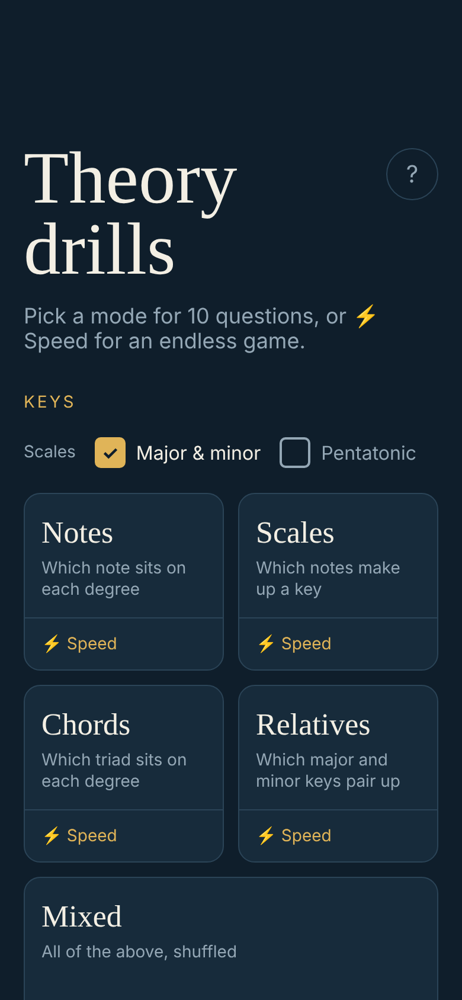
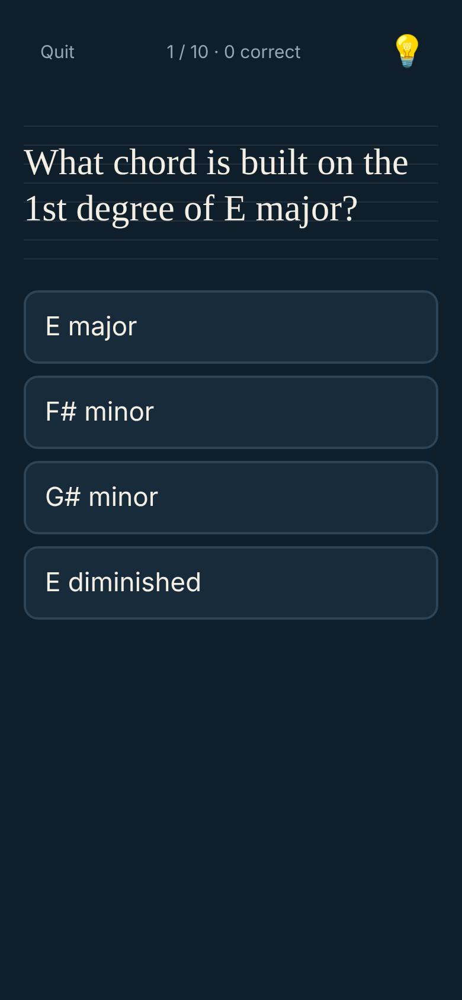
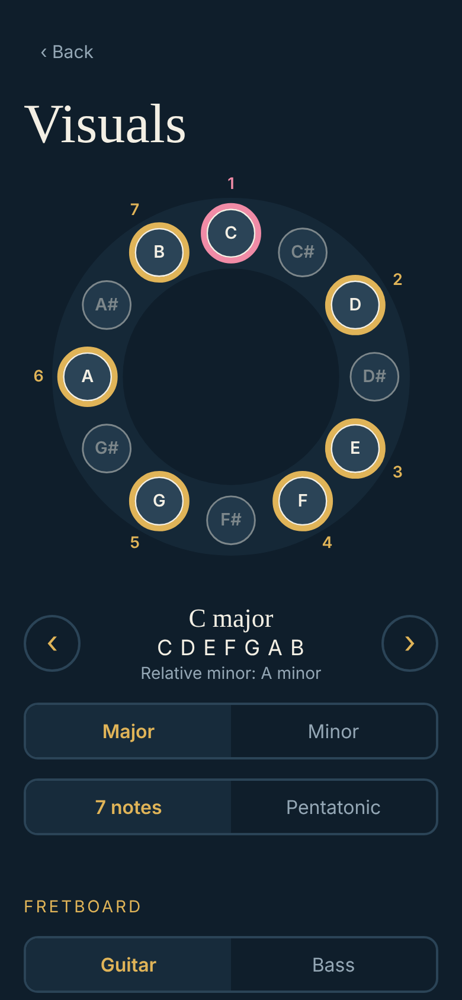
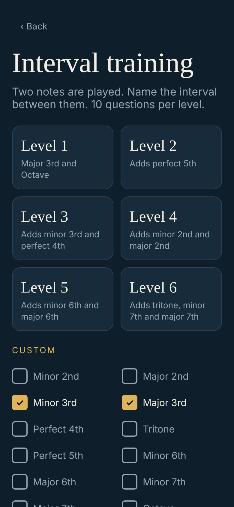

# Theory drills

A small, mobile-first web app for practising music theory, the guitar fretboard and ear training. It installs as a PWA and works offline once loaded.

<p>
  
  
  
  
</p>

## What's inside

| Section | What you practise | Example |
|---|---|---|
| **Keys** | Notes, scales, chords and relative keys (major/minor, optionally pentatonic) | *"What chord is built on the 1st degree of E major?"* → E major |
| **Memorize the fretboard** | Note names on guitar and bass, frets 0–12 | *"What note is on the 1st fret of the B string?"* → C |
| **Play on guitar** | Answer by playing into the mic: key notes, fretboard notes, play-it-back and scale runs | *"Play the 5th note of G major"* → you play any D |
| **Ear training** | Intervals, chord qualities and scale degrees, in levels or a custom set | Two notes play; you pick *Major 3rd* |
| **Visuals** | A key's notes on a circle and on the neck | C major lights up C D E F G A B |
| **Tools** | Metronome and a guitar/bass tuner | |

### How a session works

- Tap a mode for **10 questions** with four choices and no time limit. The 💡 button opens a cheat sheet (scale formulas, triads per degree, relative keys), and at the end you can review what you missed.
- Tap **⚡ Speed** for an endless game: 5 hearts, a 20-second limit that shrinks with every correct answer, and a best score saved on your device.
- The **?** button on the home screen explains every mode.

## Run it locally

```bash
npm install
npm run dev      # start the dev server
npm test         # run the Vitest suite
npm run build    # production build in dist/
```

Built with React and Vite. Specs for every feature live in [`openspec/specs`](openspec/specs); see [OPENSPEC.md](OPENSPEC.md) for how changes are planned.

## Free to use

This project is completely free. Take the code, fork it, change it, ship it, use it commercially, no permission needed. It's released under the [MIT License](LICENSE).

The audio samples are third-party and licensed **CC BY 3.0**, so keep the credit if you reuse them:

- Piano: Salamander Grand Piano by Alexander Holm
- Acoustic guitar: tonejs-instruments by Nicholaus Brosowsky, from University of Iowa recordings (notes shortened)
